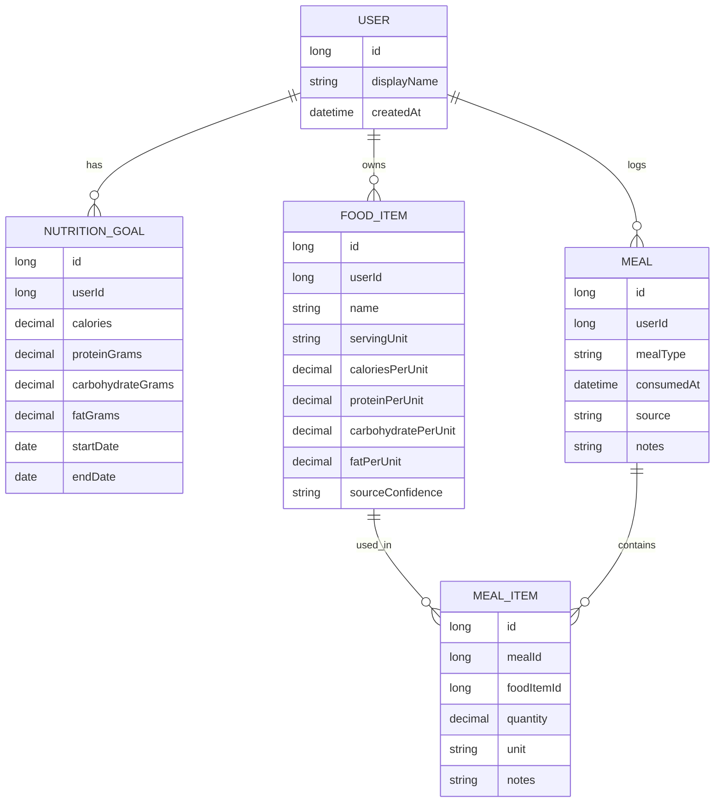

# Initial domain model and ER sketch

## 1. Domain model summary

The first domain model focuses on the minimum entities needed to support meal logging and nutrition totals:

- `User`
- `NutritionGoal`
- `FoodItem`
- `Meal`
- `MealItem`

This avoids introducing pantry, recipe, or supplier concepts before the core calculations and persistence patterns are proven.

## 2. Domain definitions

### User
A single user profile for the application. In the first release, the app is effectively single-user, even if future user accounts are planned.

Key attributes:
- id
- name or display name
- createdAt

### NutritionGoal
Stores a daily macro and calorie target for a user.

Key attributes:
- id
- userId
- calories
- proteinGrams
- carbohydrateGrams
- fatGrams
- startDate
- endDate (optional)

### FoodItem
Represents an ingredient or food product used in meals.

Key attributes:
- id
- userId
- name
- servingUnit
- caloriesPerUnit
- proteinPerUnit
- carbohydratePerUnit
- fatPerUnit
- sourceConfidence (exact / estimated)
- createdAt

### Meal
Represents a meal event consumed by the user.

Key attributes:
- id
- userId
- mealType (breakfast, lunch, dinner, snack, other)
- consumedAt
- notes
- source (home_cooked, restaurant, custom, other)
- createdAt

### MealItem
Links a food item to a meal with a quantity.

Key attributes:
- id
- mealId
- foodItemId
- quantity
- unit
- notes (optional)

## 3. ER sketch

## 4. Calculations and invariants

A meal total is calculated as:

- totalCalories = sum(foodItem.caloriesPerUnit * mealItem.quantity)
- totalProtein = sum(foodItem.proteinPerUnit * mealItem.quantity)
- totalCarbohydrate = sum(foodItem.carbohydratePerUnit * mealItem.quantity)
- totalFat = sum(foodItem.fatPerUnit * mealItem.quantity)

All calculations should be derived from the `MealItem` rows and the associated `FoodItem` nutrient values. This keeps the model simple and reduces risk of drift.

## 5. Initial storage and architectural intent

The first persistence shape is a relational model using PostgreSQL in a Spring Data JPA setup. Each table will carry explicit identifiers and foreign keys. This is compatible with future additions like recipes, pantry transitions, and later external integrations.

## 6. Key design decisions

- Keep `Meal` and `MealItem` separate to allow one meal to contain multiple ingredients and future quantity corrections.
- Keep nutrition values on `FoodItem` rather than duplicating them in `MealItem` to reduce inconsistency.
- Treat `NutritionGoal` separately from `Meal` so targets can evolve over time without rewriting intake history.
- Use `sourceConfidence` on `FoodItem` as a placeholder for exact-vs-estimated nutrient values; do not pretend all numbers are exact.
